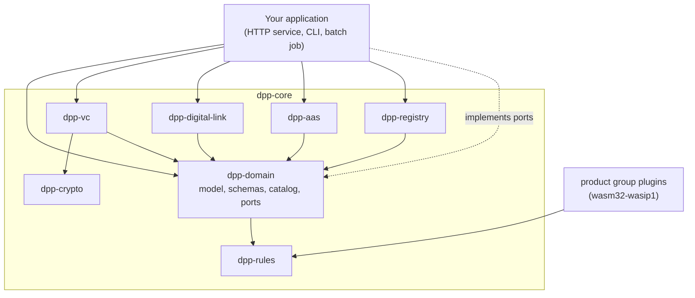

# dpp-core

An open-source Rust library for EU Digital Product Passports (DPPs), under the
Apache License 2.0. It holds the passport data model, versioned JSON Schemas per
product group, regulatory validation rules, Ed25519/JWS signing, W3C Verifiable
Credentials, product identifiers under three EN 18219 schemes (GS1, identification
link, DID) with GS1 Digital Link parsing and building, and Asset Administration Shell
export. It is stateless: no database, no HTTP server, no network I/O.

[](https://crates.io/crates/dpp-domain)
[](https://docs.rs/dpp-domain)
[](https://github.com/odal-node/dpp-core/actions/workflows/ci.yml)
[](https://github.com/odal-node/dpp-core/actions/workflows/advisories.yml)
[](https://github.com/odal-node/dpp-core/actions/workflows/fuzz.yml)
[](https://github.com/odal-node/dpp-core/actions/workflows/wasm-build.yml)
[](LICENSE)
[](Cargo.toml)
[](https://docs.odal-node.io/core/overview/)
[](#dpp-core)

Checked in CI against independent implementations of the standards it follows:

[](https://github.com/odal-node/dpp-core/actions/workflows/gs1-oracle.yml)
[](https://github.com/odal-node/dpp-core/actions/workflows/did-oracle.yml)
[](https://github.com/odal-node/dpp-core/actions/workflows/jsonld-oracle.yml)
[](https://github.com/odal-node/dpp-core/actions/workflows/sdjwt-oracle.yml)
[](https://github.com/odal-node/dpp-core/actions/workflows/jades-oracle.yml)
[](https://github.com/odal-node/dpp-core/actions/workflows/aas-oracle.yml)

> [!NOTE]
> **Status: pre-production.** Published on crates.io and tested in CI, but not yet
> used in production. Before 1.0, a minor version may change public APIs; every
> change is listed in [CHANGELOG.md](CHANGELOG.md).

## Quick start

Validate product data against its regulatory schema, sign it, and verify the
signature. This uses only the published crates.

```bash
cargo new hello-dpp && cd hello-dpp
cargo add dpp-domain dpp-crypto serde_json anyhow
```

Replace `src/main.rs` with:

```rust
use dpp_crypto::{jws::signer, keystore::KeyStore};
use dpp_domain::schemas::VersionedSchemaRegistry;
use serde_json::json;

fn main() -> anyhow::Result<()> {
    // 1. Validate product data against the embedded, versioned JSON Schema.
    let schemas = VersionedSchemaRegistry::new();
    let (version, _) = schemas.latest("battery").expect("battery schema is embedded");

    // An industrial LFP battery of 4.8 kWh: over the 2 kWh line above which the
    // Battery Regulation requires a passport for an industrial battery.
    let data = json!({
        "productIdentifier": { "scheme": "gs1", "gtin": "09506000134352" },
        "batteryType": "industrial",
        "batteryChemistry": "LFP",
        "nominalVoltageV": 48.0,
        "nominalCapacityAh": 100.0,
        "ratedCapacityKwh": 4.8,
        "expectedLifetimeCycles": 3000
    });

    if let Err(e) = schemas.validate("battery", version, &data) {
        for err in &e.errors {
            println!("invalid at '{}': {}", err.field, err.message);
        }
        anyhow::bail!("validation failed");
    }
    println!("valid against battery schema v{version}");

    // 2. Sign it as a compact JWS with an Ed25519 key from an encrypted keystore.
    let store = KeyStore::open(std::env::temp_dir().join("hello-keys.json"), "change-me")?;
    if store.public_key("issuer").is_none() {
        store.generate_key("issuer")?;
    }
    let kid = store.public_key("issuer").expect("generated above").thumbprint_uri()?;
    let jws = signer::sign(&store, "issuer", &data, &kid)?;

    // 3. Verify the signature.
    println!("signature verifies: {}", signer::verify(&store, "issuer", &jws)?);
    Ok(())
}
```

```bash
cargo run
```

```text
valid against battery schema v2.10.0
signature verifies: true
```

The schema version is the newest one the installed `dpp-domain` embeds. The first build
compiles the dependency tree, which takes about a minute. Remove `"batteryType"` from
the data and the run stops with
`invalid at '': "batteryType" is a required property`.

More runnable examples, one per crate:

```bash
git clone https://github.com/odal-node/dpp-core && cd dpp-core
cargo run -p dpp-domain --example create_passport          # build, validate and publish a battery passport
cargo run -p dpp-crypto --example sign_and_verify          # keystore, Ed25519 key, JWS
cargo run -p dpp-vc --example credential_and_transfer      # issue a credential, transfer responsibility
cargo run -p dpp-digital-link --example parse_and_negotiate # parse a GS1 Digital Link, pick a link type
cargo run -p dpp-aas --example passport_to_aas             # map a passport to an AAS shell
cargo run -p dpp-rules --example regulatory_rules          # cross-field regulatory rules
cargo run -p dpp-calc --example calculate_metrics          # CO2e and repairability calculators
cargo run -p dpp-registry --example registry_identifiers   # EU registry identifiers
```

## Crates

| Crate | What it does |
|---|---|
| [`dpp-domain`](crates/dpp-domain) | Passport data model, port traits, the instrument catalog (which act applies to which product group, from when), per-field disclosure policy, and the versioned JSON Schemas |
| [`dpp-crypto`](crates/dpp-crypto) | Ed25519 keys, compact JWS, JCS canonicalisation, JAdES baseline construction, SD-JWT selective disclosure, and an AES-256-GCM keystore with Argon2id key derivation |
| [`dpp-vc`](crates/dpp-vc) | W3C Verifiable Credentials, `did:web` documents, Bitstring Status List revocation, SD-JWT VC, and the JSON-LD context |
| [`dpp-digital-link`](crates/dpp-digital-link) | GS1 Digital Link parsing and building, and link-type negotiation |
| [`dpp-aas`](crates/dpp-aas) | Asset Administration Shell projection of a passport: shells and per-product-group submodels |
| [`dpp-rules`](crates/dpp-rules) | Cross-field regulatory rules, `no_std` with no dependencies, shared by `dpp-domain` and the Wasm plugins |
| [`dpp-calc`](crates/dpp-calc) | CO2e and repairability calculators following EU methodologies, as pure functions; licensed factor data is injected, never bundled |
| [`dpp-registry`](crates/dpp-registry) | EU DPP registry request and response types, and the identifier mapping |
| [`dpp-plugin-traits`](crates/dpp-plugin-traits) | Host and guest contract for Wasm product group plugins |
| [`dpp-plugin-sdk`](crates/dpp-plugin-sdk) | Guest-side SDK: the `export_plugin!` macro and a field `Validator` |
| [`dpp-vocab`](crates/dpp-vocab) | Register of external vocabularies: who publishes a term, under which licence, and what was verified |
| `dpp-tests` | Cross-crate integration tests and structural checks (not published) |

[`plugins/`](plugins) holds eleven product group plugins, built separately for
`wasm32-wasip1`. `dpp-domain`, `dpp-registry`, `dpp-digital-link` and `dpp-aas` also
build for `wasm32-unknown-unknown`.

## How it fits together

The library does no I/O. Anything that stores a passport, signs with a remote key,
seals, or talks to the EU registry is a **port trait** that the application
implements.



| Port trait | Kind | Implement it to |
|---|---|---|
| `PassportRepository` | async | Store and load passports |
| `ComplianceRegistry` + `ComplianceStrategy` | sync | Dispatch product-group-specific compliance checks |
| `IdentityPort` | async | Sign and verify passport JWS |
| `PluginHost` | sync | Run Wasm product group plugins |
| `BackupCopyPort` | async | Hold the independent back-up copy required by ESPR Art. 10(4) |
| `ArchivedVersionPort` | async | Keep a passport's historical versions (EN 18221 clause 4.2) |
| `PersonalDataPort` | async | Keep erasable personal data outside the signed passport |
| `RegistrySyncPort` | async | Register passports with the EU registry and track their status |
| `SealPort` | async | Apply an eIDAS qualified electronic seal |

The crate ships defaults and test doubles: `PassthroughRegistry`,
`LocalIdentityService` in `dpp-vc`, the in-memory implementations behind the
`test-utils` feature, and stub implementations of the backup, registry and seal
ports (`GhostBackup`, `GhostRegistrySync`, `GhostSeal`). A stub reports itself as
one, so an application can refuse to run on it in production.

## What the library models

**Product groups as data.** Each product group (battery, textile, electronics, steel,
aluminium, construction, detergent, furniture, mattress, toy, tyre, and the
unsold-goods disclosure) is an embedded manifest in
[`crates/dpp-domain/product-groups/`](crates/dpp-domain/product-groups) with
versioned schemas under [`crates/dpp-domain/schemas/`](crates/dpp-domain/schemas).
The manifest's `currentSchemaVersion` is the source of truth for the current
version. Old passports stay readable: read-time lenses upcast older product data to
newer schema versions without touching the signed bytes.

**Applicable law as a set.** `InstrumentCatalog` records, per act and product group,
whether a passport is required and from when. Several acts can apply to one product
group at once (ESPR Art. 5(7) sets no precedence), so a determination is always made
under a named act.

**Per-field disclosure.** Battery Regulation Art. 77(2) assigns Annex XIII data to
three audiences, and the assignment is not a ranking: conformity test reports go to
authorities only, and individual-battery use data goes to legitimate-interest holders
only. `Audience::may_see(Disclosure)` encodes the table. Other product groups use the
same vocabulary through their manifest's `disclosure` map.

| Audience | Battery Annex XIII | Sees |
|---|---|---|
| Public | point 1 | Battery-model information. No credential. |
| Legitimate interest | points 2 and 4 | Composition, dismantling, safety, and individual-battery data (state of health, use history). Needs a Verifiable Credential proving the interest. |
| Authority | points 2 and 3 | Point 2 data and conformity test reports, but not point 4 individual data. |

**Product identifiers under EN 18219 clause 5.** `ProductIdentifier` covers the
three schemes the standard offers as alternatives: a GS1 GTIN, an Identification
Link (EN IEC 61406 URL), and a DID. Schemes 2 and 3 need no GS1 membership.
Deserialisation goes through the constructors, so an invalid identifier cannot be
read back. A data carrier is not an identifier: `dpp-registry` maps a
`ProductIdentifier` to the registry's form and refuses an unmapped scheme instead
of deriving one from a carrier URL.

**Transfer of responsibility.** `TransferChain` is an append-only state machine of
handovers between economic operators. The outgoing operator signs the handover; the
hosting node records an attestation that the incoming operator accepted it. That
attestation is not the incoming operator's signature. The authoritative record of
who holds the obligations is the EU registry (Implementing Regulation (EU)
2026/1778, Art. 6a).

**Wasm plugins.** Product-group compliance checks can ship as sandboxed Wasm modules.
The ABI negotiates capabilities and a supported schema-version range;
`product-group-battery` is the reference implementation. See
[`plugins/README.md`](plugins/README.md) and
[`crates/dpp-plugin-sdk`](crates/dpp-plugin-sdk).

## Develop

```bash
cargo build --workspace          # needs no database, no services, no environment variables
cargo nextest run --workspace    # unit and integration tests
just check                       # the CI gate: fmt, clippy, tests, doctests, plugins, docs, lockfiles, audit
```

`just check` compiles in parallel and can exhaust memory on a 16 GB machine; set
`CARGO_BUILD_JOBS=3` if it does. [CONTRIBUTING.md](CONTRIBUTING.md) covers setup,
conventions and the pull request flow.

## Documentation

- **API reference:** [docs.rs](https://docs.rs/dpp-domain), one page per crate.
- **Guided index:** [docs/README.md](docs/README.md), grouped by question.
- **Architecture:** [OVERVIEW.md](docs/architecture/OVERVIEW.md),
  [DATA-MODEL.md](docs/architecture/DATA-MODEL.md),
  [IDENTITY.md](docs/architecture/IDENTITY.md),
  [PLUGIN-HOST.md](docs/architecture/PLUGIN-HOST.md).
- **Regulation:** [COMPLIANCE.md](docs/regulatory/COMPLIANCE.md) maps code to law,
  article by article; [CONFORMITY.md](docs/regulatory/CONFORMITY.md) is the
  alignment statement for assessment bodies.
- **Standards:** [STANDARDS.md](docs/architecture/STANDARDS.md) records each IETF,
  W3C, GS1, IDTA and ETSI specification the code uses, at which revision. A test
  fails when code cites an IETF document the register does not list.

## Regulatory scope

| Act | What the library implements |
|---|---|
| ESPR, Regulation (EU) 2024/1781 | Passport data model (Arts. 9 to 13, Annex III), per-actor access rights, the unsold-goods disclosure (Arts. 24 and 25) |
| Battery Regulation, Regulation (EU) 2023/1542 | Battery passport content (Annex XIII), per-category mandatory fields, the Art. 77(2) access assignment |
| Detergents, toys, construction products, phones and tablets | Product group manifests and schemas, each bound to its act in the instrument catalog |
| Delegated acts not yet adopted (textiles, steel and others) | Provisional schemas, marked as such, that follow the act as it is adopted |
| Other acts (end-of-life vehicles, packaging, critical raw materials) | Recorded in the instrument catalog; no product group is bound to them yet |

Passport start dates are in the instrument catalog, not in this README, so they are
never copied out of date.

**Harmonised standards.** Commission Implementing Decision (EU) 2026/1736 cites six
DPP system standards (EN 18216, 18219, 18220, 18221, 18222 and 18223). The code
follows parts of them, but **no conformance is claimed**: the ESPR Art. 41(2)
presumption requires a clause-by-clause assessment, and none has been published.

## Licence

[Apache License 2.0](LICENSE).

## Security

Report vulnerabilities privately to **security@odal-node.io**, never in a public
issue. See [SECURITY.md](SECURITY.md).
