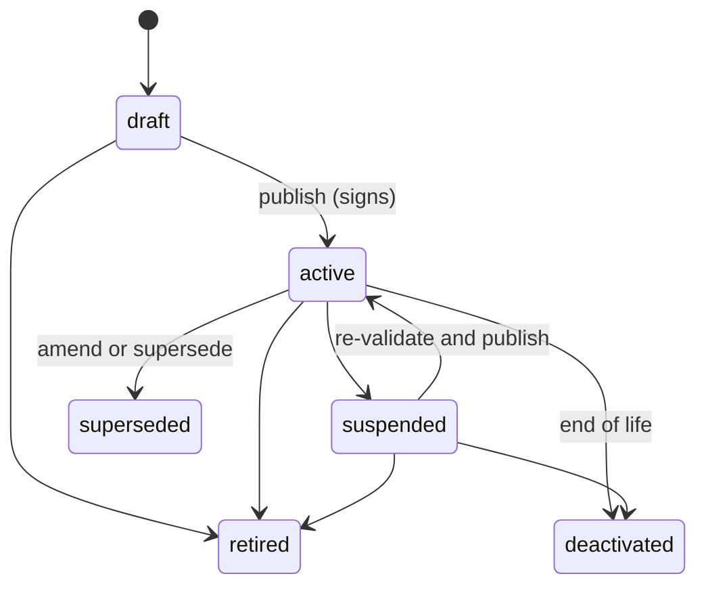

# Domain architecture overview

What a Digital Product Passport is in this library, how it moves through creation,
signing and resolution, and what a signature does and does not guarantee.

This is the domain model, independent of infrastructure. Any application that
implements the port traits in `dpp_domain::ports` correctly has a working passport
system.

---

## 1. Ports and adapters

The library follows hexagonal architecture (ports and adapters). Domain logic (schema
validation, lifecycle transitions, signing orchestration) is isolated from everything
external.

The domain is pure Rust functions and trait definitions. Every external dependency
(database, cache, event bus, file storage) sits behind a trait, so:

- the domain is tested with in-memory implementations, without containers or network
  calls;
- any infrastructure component can be replaced without touching regulatory logic;
- the same domain code compiles to native targets, `wasm32-unknown-unknown` and
  `wasm32-wasip1`.

---

## 2. Passport lifecycle



| Transition | Precondition | Effect |
|---|---|---|
| `draft` to `active` | Every mandatory field present and valid | Signed with the issuer's Ed25519 key; JWS produced |
| `active` to `suspended` | A stated reason (recall, investigation and so on) | Signature kept; a resolver answers 410 |
| `active` to `superseded` | A published successor whose `supersedes_id` points back | The old record stays readable |
| `active` or `suspended` to `deactivated` | End of life (recycled, destroyed under a derogation, exported, lost) | Terminal; the record is kept |
| `draft`, `active` or `suspended` to `retired` | Irreversible | A published record is kept until `retentionUntil`, computed at publish from the instrument bindings. A draft retired before publishing has no `retentionUntil` |

`retired`, `superseded` and `deactivated` are terminal. Your application records every
transition; audit storage is its concern, not the domain's.
[DATA-MODEL.md §2](DATA-MODEL.md#2-passport-lifecycle) has the full table.

**Retention.** The period is not a constant in this document or anywhere else in prose.
It is the **maximum** across every recorded `InstrumentBinding` that reaches the product
group (periods are floors, so a record kept for the longest satisfies them all), and it
carries the provenance of the figure that produced it: the fold is `Sourced` only when
*every* contributing figure is. Every figure recorded today happens to be 10 years,
several of them `Assumed` rather than read from an adopted text, which is why the number
is not written here as though it were settled.

---

## 3. Data flow

```text
WRITE PATH
1. Manufacturer submits product data (JSON or CSV)
2. Data validated against the product group's JSON Schema (VersionedSchemaRegistry)
3. Compliance checks run through ComplianceRegistry (Wasm plugin or passthrough)
4. Validated data persisted through PassportRepository
5. On publish: canonical JSON signed with Ed25519 through IdentityPort (compact JWS)
6. Registration queued for the EU registry through RegistrySyncPort

READ PATH
1. Consumer scans the QR code on the product
2. Resolver fetches the passport through PassportRepository
3. JWS verified against the manufacturer's did:web DID document
4. Passport served with its verification status
```

---

## 4. Trust anchor

**Question:** when someone scans a QR code, how do they know the passport data is
authentic?

**Answer: a JWS checked against a `did:web` document.** Every published passport carries
a compact JWS made with the signing operator's Ed25519 private key. The matching public
key is published in that operator's `did:web` DID document at `/.well-known/did.json`.

To verify:

1. Fetch the operator's DID document.
2. Resolve the verification method the JWS `kid` names, with the binding checks in
   [IDENTITY.md](IDENTITY.md): the document is the one the `kid` names, the method belongs
   to it and is listed under `assertionMethod`, a thumbprint `kid` is the key's own, and a
   declared `alg` matches the header.
3. Verify the JWS signature over the payload with that key.
4. If it is valid, the data is byte for byte what the operator signed.

**Trust root:** DNS and HTTPS (`did:web`), the same infrastructure that secures the
manufacturer's own website.

**What a signature does not guarantee:** that the data is accurate. It proves who
published the data and that nothing changed since. Whether the values are correct
remains the manufacturer's responsibility.

---

## 5. Key rotation

Key rotation is a normal operation:

1. The current Ed25519 key is archived with a timestamp.
2. A new key pair is generated and listed first in the DID document (primary,
   authentication).
3. Archived keys stay under `assertionMethod`, each keeping its identifier: the DID and
   the key's own thumbprint, which no rotation changes.
4. Every earlier JWS stays verifiable against its archived key.

A manufacturer can rotate keys without invalidating any published passport.

---

## 6. Compliance model

`ComplianceRegistry` is where a compliance determination is made. The library ships the
product-group-agnostic `PassthroughRegistry`:

```text
ComplianceRegistry
  +-- PassthroughRegistry (this library)      -> PassthroughNoValidation for every product group
  +-- plugin-backed registry (in a host)      -> Wasm product group plugins compute real metrics
  +-- registry fed by signed ruleset bundles  -> format in dpp_rules::bundle; no implementation yet
```

`PassthroughRegistry` computes nothing: it accepts manufacturer-supplied values verbatim
and returns `PassthroughNoValidation` for every product group. Real validation (CBAM
thresholds, the ESPR Arts. 24 and 25 unsold-goods rules, Battery Regulation checks)
comes from the Wasm product group plugins, through a plugin-backed registry in a host. A
computed determination passes through
`gate_determination(catalog.is_in_force(product_group), …)`, so a provisional product
group can never produce a binding `Compliant` or `NonCompliant`. See
[PLUGIN-HOST.md](PLUGIN-HOST.md).

The trait is a technical extension point. Open Wasm plugins, a host's calculators or
third-party modules can implement or extend it without touching any other code.

---

## 7. Schema versioning

Schemas follow semver. `VersionedSchemaRegistry` holds every version listed in
`crates/dpp-domain/src/schemas/embedded.rs`, one file per version:

```text
crates/dpp-domain/schemas/
  battery/v1.0.0.json … v2.10.0.json
  textile/v1.0.0.json … v1.4.0.json
  unsold-goods/v2.0.0.json
  …
```

A new version is a new file plus one entry in that table (see
[CONTRIBUTING.md §6](../../CONTRIBUTING.md#6-changing-a-schema)). Callers validate
against the version a passport declares, or ask for the latest.

---

## 8. Issuer model

The library is single-issuer and stateless: it has no concept of tenants,
authentication or API keys. An issuer is identified by a `key_id` that maps to an
Ed25519 key pair in the `KeyStore`, and by a `did:web` DID derived from the issuer's
domain.

Multi-tenancy, authentication and access control belong to your application, not to this
library.

---

## 9. Port traits

These traits are the boundary between the library and any implementation:

```rust
// Persistence
trait PassportRepository    // CRUD for passport records

// Compliance
trait ComplianceRegistry    // Route to a product group strategy
trait ComplianceStrategy    // Product-group-specific validation

// Identity
trait IdentityPort          // Sign and verify JWS

// Plugins
trait PluginHost            // Dispatch to Wasm plugins

// Back-up copy, archive, personal data, registry and sealing
trait BackupCopyPort        // The ESPR Art. 10(4) third-party back-up copy
trait ArchivedVersionPort   // The EN 18221 clause 4.2 archive of historical versions
trait PersonalDataPort      // Erasable records of personal data held outside a passport
trait RegistrySyncPort      // EU registry registration and status sync
trait SealPort              // eIDAS qualified electronic seal (ESPR Art. 13)
```

`PassportRepository`, `IdentityPort`, `BackupCopyPort`, `ArchivedVersionPort`,
`PersonalDataPort`, `RegistrySyncPort` and `SealPort` are `async`. The compliance and
plugin traits are synchronous, because they must work in `no_std` and `wasm32` contexts.

`dpp-vc` provides `LocalIdentityService`, an `IdentityPort` implementation backed by
`dpp-crypto`'s local `KeyStore`. Implementing the remaining traits against your own
infrastructure gives a complete passport system. [PORTS.md](PORTS.md) lists each trait
and its implementations.
